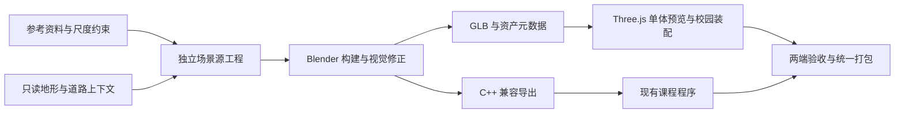

# 3D 建模与校园场景工作流 v1

决策日期：2026-11-06。适用范围：当前粤海校区项目，以及后续从中提炼的建筑与场所建模 skill。

**最新执行优先级：按用户要求，先逐栋完善建筑外观、入口门、楼梯、砖/块材平台及与道路的衔接，通用 skill 封装后置。元平首轮修复已同步到校园预览，见 [元平验收记录](modeling/元平入口与道路边界_验收.md) 和 [建筑边界清单](modeling/BUILDING_BOUNDARIES.md)。下面 M0–M3 是保留的技术路线，不覆盖这个最新优先级。**

**状态：M0 已实现并通过独立打包验收；立德门独立资产与其校园 integrate 已实现，通用 skill 和其他大场景装配尚未完成。当前按最新优先级逐处修复建筑入口，进度见 [CURRENT_WORK.md](modeling/CURRENT_WORK.md)。doctor、build、probe-build、preview、validate、package 可用于已支持的资产；integrate 目前只支持经核验的立德门。**

## 1. 已确定的方向

采用 **Blender 独立建模，从同一场景分别生成 GLB 标准资产与 C++ 兼容资源，再由 Three.js 和课程程序各自加载验收**。

质量顺序为：空间关系与尺度正确、必要连接可通行、标志性轮廓准确、近景结构和材质细化、性能与交付验证。全校保留可识别的基础体量，重点地点独立精建；精度按实际观看距离分配，不给所有建筑堆同样的细节。

- Blender 是几何、UV、材质和构件层级的制作工具；重复构件采用 Array、曲线、实例或必要的 Geometry Nodes。
- Python 脚本承担可复现构建、检查、导出和打包。默认通过独立的 Blender 后台进程执行，MCP 只作为后续可选的交互编辑通道。
- GLB 是标准运行与分发资产；JSON 补充资产身份、连接点、行走语义和场景放置关系。
- Three.js + TypeScript + Vite 提供独立资产检查、局部组装和校园浏览。第一版采用 WebGLRenderer；先实现轨道相机、图层检查、固定机位和测量，再补需要的漫游操作。
- C++/OpenGL 保留课程展示、现有交互及根目录 CMake 构建。通过兼容出口接入新资产，按地点渐进替换。
- 第一版不引入完整物理引擎、远程资产平台或通用任务调度框架。AI 生成模型可作草稿或装饰候选，地标结构仍需参考资料和多视角核查。



## 2. 资产边界：本体、地块、校园

| 层次 | 负责的内容 | 允许依赖 |
| --- | --- | --- |
| 本体 | 建筑、桥、门及其构件、材质、局部轴心 | 自身参数、源工程和显式的共享构件库 |
| 地块 | 入口、台阶、庭院、铺装、局部地形适配 | 本体和裁剪后的只读上下文快照 |
| 校园 | 每个地点的位置、朝向、基准高程、连接关系与加载范围 | 已验收资产包和校园基础层 |

一个“地点资产”可以包含本体和地块两个子根节点。例如首轮周南桥迁移包包含下层人行桥、斋区端楼梯和接口，上层作为只读参考；这些节点拥有独立职责，但可以一起分发。

资产内部使用局部米制坐标。单独重建一个地点不得导入 `generate_campus.py`、读取整个校园 OSM 或隐式重写全校园资源。必要的地形、道路和邻楼轮廓在准备阶段裁剪成上下文，并记录来源文件与 SHA-256。

上下文集合只供采样、避让与检查，不随模型导出。地块声明边界、接地面、接缝带及要替换的旧资源/区域；集成时同时关闭被替代的旧面，避免共面闪烁和重复绘制。首轮优先替换完整的独立图层；涉及共享道路时，必须先实现有边界的切割拼接并检查接缝，不通过全局重生成完成局部替换。

## 3. 工具与依赖决策

| 环节 | 首轮选择 | 管理方式 |
| --- | --- | --- |
| 建模执行 | 本机 Blender 4.5.3 LTS | 首轮固定基线；由 `BLENDER_EXE` 或探测器定位，版本写入构建记录 |
| 外部编排 | Python 3.12 | 独立虚拟环境；Blender 内的 `bpy` 使用 Blender 自带 Python |
| 地图/上下文处理 | 现有 NumPy、Pillow、Shapely、mapbox-earcut 路线 | 独立于 Blender 建模依赖；首次验证后锁定实际版本 |
| Web 预览 | Three.js + TypeScript + Vite | 实施时解析兼容版本并提交 package-lock；之后使用 `npm ci` |
| 资产优化 | glTF Transform | 首轮先交付未压缩的正确资产；需要时做去重、清理和贴图缩放 |
| 格式检查 | Khronos glTF Validator + 导出回读 | 检查格式、实际几何和引用，不把格式通过等同于外观正确 |
| 课程出口 | 现有 C++11、GLFW、GLAD、GLM、CMake | 继续根目录统一构建和调试 |

本次已执行版本探测：Blender 4.5.3、Node v24.13.0、主机 Python 3.12.7。主机 Python 中检测到 NumPy 1.26.4、Pillow 10.4.0，未检测到 Shapely/mapbox-earcut；这仅说明当前解释器状态，不代表其他虚拟环境不可用。首轮环境准备须定位既有环境或创建专用环境，不能直接宣称已经具备完整构建条件。

现有 Blender 可执行文件位于 `build/campus-opensource-review/blender-pilot/blender-4.5.3-windows-x64/blender.exe`。这是本机发现路径，不能成为分发包的硬编码依赖；工具探测失败时应明确列出缺项。第三方 skill 中的 5.x API 需要按这个基线检查后使用。

### 开源复用范围

- [mattjamo/bpy_skill](https://github.com/mattjamo/bpy_skill)：参考建模、看图、几何检查的反馈循环及后台执行方式。
- [kajisho5/blender-skill](https://github.com/kajisho5/blender-skill)：优先评估资产检查、转换、拆包和 scene.json 装配代码。
- [czlonkowski/blender-web-3d-skill](https://github.com/czlonkowski/blender-web-3d-skill)：参考按根节点导出和 Three.js 查看器；移除示例特有样式，禁止沿用会改变真实尺度的归一化装配。
- [glTF Transform](https://github.com/donmccurdy/glTF-Transform)：作为可选导出后处理工具；保留连接点、动件祖先和语义节点。

采用少量明确需要的脚本/模板，不同时安装数套相互重叠的总控 skill。实际复用时固定上游 commit、保留许可证和修改记录，先在隔离夹具中测试。首轮不依赖任何 MCP 服务即可完成构建、导出和验收。

## 4. 源工程和输出组织

目标结构按实施阶段逐步建立，不预先创建空目录：

```text
main/end/
  PIPELINE.md
  modeling/
    assets/<asset-id>/
      asset.json               输入约定、作者模式、参数、角色和连接点
      references/              来源、约束、可随包使用的参考材料
      source/                  build.py + 参数，或 model.blend + 纹理
      context/                 裁剪的只读上下文及哈希
      views.json               固定验收机位与相关路径
    scenes/yuehai.scene.json   资产实例、放置变换、邻接关系和基础层
    viewer/                    Three.js 查看器
tools/end/pipeline.py           统一命令入口，待实现
build/modeling-pipeline/
  <asset-id>/<run-id>/          源工程结果、标准出口、兼容出口、截图和报告
  releases/                   从已验收结果生成的可分发包
```

每项资产只允许一种权威编辑模式：

- `procedural`：`build.py + 参数 + 输入资源` 是源；生成的 `.blend` 是可查看的产物。默认采用此模式，便于重复构建和修改。
- `blend`：人工精修后的 `.blend + 纹理` 是源；脚本只负责读取、验证、导出。若从程序模式转入此模式，必须显式切换并保存原生成脚本的出处，避免重新生成覆盖精修。

可以通过 Python 在 Blender 中精修，两种模式的区别是“下一次重建读取谁”，而不是是否手工点击。源工程不能仅保存在 `build` 临时目录。

## 5. 最小资产协议

输入 `asset.json` 和输出 `manifest.json` 分开：前者是制作约定，后者记录实际导出结果。具体 JSON Schema 在 M0 实施，必须覆盖以下字段。

| 字段组 | 必须表达的含义 |
| --- | --- |
| 身份 | `schema_version`、稳定 `asset_id`、资产版本、显示名称、`source_mode` |
| 输入 | 源路径、参数、随机种子、依赖文件及哈希、上下文版本 |
| 坐标 | 米制单位、局部原点、轴约定；校园放置只存场景清单 |
| 结构 | 稳定节点 ID、父子关系、局部变换、节点角色 |
| 接口 | 入口、桥端、台阶顶底等连接点的位置、朝向、净宽/净高及所属通行层 |
| 语义 | `visual`、`walkable`、`collider`、`interactive`；无此角色时明确为空 |
| 交互 | 必要的轴心、旋转轴、限制范围和语义动作；由运行端实现输入控制 |
| 地块 | 边界、接缝范围、参考接地面、旧面替换范围与上下文哈希 |
| 导出 | GLB/兼容出口的包内相对路径、包围盒、面数、材质数、贴图大小及 SHA-256 |
| 证据 | 参考来源、可确认事实、推定尺寸、未知部分、固定机位和验证结果 |

路径限定在包内，禁止绝对源码路径。GLB 自包含几何和贴图；连接/碰撞等应用语义由 sidecar 提供，不能假设所有 glTF 加载器都会自动实现这些行为。单体包优先自包含，复制少量共享贴图可以接受；校园运行时的去重属于装配优化。

### 坐标和变换

- 现有校园为米制、右手系：X 向东、Y 向上、Z 向南；现有经纬度原点和近似投影保持在校园适配层，不写入通用 skill。
- Blender 作者坐标采用 X 向右、Y 向前、Z 向上；对齐校园时分别对应东、北、上。标准出口采用 glTF 的 Y-up 右手系，向量转换为 `(x, y, z) → (x, z, -y)`。
- GLB 由 Blender 标准导出器完成轴转换，调用端不能再次手动转换；自有格式出口单独使用同一约定。
- 校园 `placement` 使用米制平移、`[x,y,z,w]` 四元数和尺度，默认尺度为 `[1,1,1]`；节点世界矩阵由父节点递推，放置只应用一次。
- 连接点、包围盒和机位 sidecar 使用导出后的 Y-up 坐标。单体预览通过调整相机取景，不修改模型真实尺寸。
- 使用至少三个不共线锚点，检查 Blender、GLB、兼容出口和校园放置的一致性；误差门槛属于数值对齐，不表示现实测量精度。

### 材质与层级

第一版采用 Principled BSDF 可导出的基础 PBR 材质和图像纹理。程序材质需要烘焙后才能成为标准运行资产；明确颜色纹理与数据纹理的色彩空间、透明模式和双面设置。默认贴图 1K–2K，标牌等可见细节再按需要提高。

GLB 保留节点层级与动件轴心。课程装配中至少有一项指定模型保留四层有实际变换继承的建模结构，并在真实运行资产上测试父节点变化和子节点随动；目录层级和孤立矩阵自检不能代替这项要求。简单地块或构件无需人为凑四层。禁止优化时合并掉必要的层级、接口和可动部件。

## 6. 统一执行循环

以下是完整目标接口；M0 已实现除 integrate 外的命令，并增加 probe-build 构建独立 C++ 验证器。从项目根目录调用，所有生成内容进入根 `build`：

```text
python tools/end/pipeline.py doctor
python tools/end/pipeline.py build <asset-id>
python tools/end/pipeline.py preview <asset-id>
python tools/end/pipeline.py validate <asset-id>
python tools/end/pipeline.py integrate <asset-id> --scene yuehai
python tools/end/pipeline.py package <asset-id>
```

1. **doctor / 准备**：确认解释器、Blender 和依赖；保存当前场景基线、输入哈希、参考和上下文。离线构建使用本地输入，资料搜索单独完成。
2. **build / 结构**：在临时输出目录生成白模，先检查轮廓、尺度、入口、楼梯和连接。可复用构件放入小型纯函数库，不调用带全局副作用的全校园生成器。
3. **preview / 精修**：检查正、侧、俯视、主要参考机位和人眼高度视角；修正最显著的结构误差后，再做 UV、材质、倒角和重复细部。美观视角不能替代背面与连接处检查。
4. **export / 出口**：build 在精修结果上调用固定导出步骤，生成 GLB 和兼容资源。重开保存的源工程并回读 GLB，验证结果可独立加载；不靠 Blender 日志中没有报错判断成功。
5. **validate / 单体**：执行格式、尺寸、层级、资源、参考图和预算检查。稳定 ID 在编辑前后保持一致，关键结构变化记录在资产版本中。
6. **integrate / 地点**：加载已验证资产及清单中的 placement，关闭对应旧资源，只更新声明的地块接缝。检查入口、相邻道路和跨层路线，同时验证无关资源哈希未变。
7. **package / 分发**：从通过验收的同一次运行结果制作包，记录版本和文件哈希；复制到独立目录重新加载。预览和课程目录均由同一已验证输出生成。

每次构建使用独立 `<run-id>`。失败保留诊断并继续使用上一版通过验收的输出；通过后才切换当前发布引用。首轮采用按资产隔离和显式依赖列表，不实现复杂增量 DAG。上下文哈希变化时，对应地块的旧集成结果失效，需要重新检查。

## 7. C++ 兼容出口

兼容适配器在同一份已保存的 Blender 场景上读取 evaluated mesh，导出 SZM1、PPM/RGBA、材质表，以及必要的节点、连接点和行走表。这样首轮无需额外开发完整 GLB 解析器。若输入本来只有 GLB，则先通过 Blender 导入到隔离工程，再进入相同检查与导出路径。

- 正确处理 modifier、父子变换和法线矩阵；现有样板直接读取原始顶点的 exporter 不能直接作为通用实现。
- 必要层级和动件使用局部 mesh + 节点局部变换表，由 C++ 适配代码递推世界矩阵。允许烘焙无需层级的静态细部，但不能把全部对象烘焙为世界坐标后丢掉课程层级。
- 基础色、图像纹理和透明裁切映射到现有材质能力；metallic/roughness、法线贴图及其他未支持通道写入转换报告，明确近似或缺失，不能静默丢弃。
- 首轮保留小巴、天鹅、门等现有控制逻辑。迁移动件时，逐项对接轴心和动作语义，不假设 GLB 动画自动成为 C++ 交互。
- 行走面与外观网格分开，兼容现有高度采样。局部行走网格登记到现有 `WalkSurfaces` 前，须应用与外观相同的节点世界矩阵和校园 placement，或由采样端正确执行坐标逆变换。碰撞数据可保存，但没有运行端碰撞实现时不得把它标为“可阻挡墙体”。
- 保持现有 UTF-8、窗口标题及根 CMake 约定。标准资产包与学校实验提交包是不同出口；课程附件的命名、`code/exe` 结构和必要资源遵从当前项目指令，单独解压验证。

## 8. 验收条件

| 关口 | 通过条件 |
| --- | --- |
| 参考与结构 | 主要轮廓、空间关系与可辨参考一致；无法证实的尺寸标为估计；保留多视角图 |
| 独立运行 | GLB、sidecar 和贴图在脱离校园源码的目录中可加载；不请求本机源码绝对路径 |
| 几何与坐标 | 无无效数值、意外零尺寸或反向轴；锚点与预期变换一致；装配不自动归一化尺度 |
| 层级与交互 | 课程指定模型的四层实体节点继承实际成立；被迁移的门/动件动作正常；既有课程交互回归通过 |
| 地形与连接 | 无明显悬空、穿地、重复面；入口和所需路线可连续通行；多层结构不错误吸附到另一层 |
| 局部性 | 仅资产和声明接缝改变；无关资源哈希保持，基线固定机位不出现非预期变化 |
| 出口与发布 | 两端自检、真实窗口/浏览器加载、相关交互与固定机位检查通过；交付哈希等于验证输出 |

不要求 Blender、Three.js、旧 OpenGL 像素完全相同；对比轮廓、朝向、尺寸、贴图、透明边缘和关键结构。薄栏杆、开放地面、玻璃不机械套用封闭实体的拓扑规则。

性能记录分为磁盘大小、几何量、材质/绘制次数、贴图分辨率、加载时间和实测帧时间。首轮优化参考线为：单地点近景约 15 万三角形以内、常用纹理不超过 2K；这是可调整的项目预算，不是工具限制。超出时用实际可见收益说明，近景装饰可放在更高精度级别。

Web 样板采用 1280×800 固定机位、预热后测量，记录设备和版本；初始体验目标为交互稳定达到约 30 FPS。需要降低负载时优先实例化重复物、降低远景细节和按地点加载，不盲目删除近景标志结构。校园组装按资产包围盒和距离管理可见范围；性能检查在实际输出上进行，不从总面数推断帧率。

## 9. 实施顺序与完成定义

### M0：最小技术闭环

建立专用环境和最小协议。使用明确标为测试夹具的四层构件、一个带轴心动件、一张基础色纹理和一个透明裁切面，构建、保存并重开 Blender 场景；从同一场景分别生成 GLB 和兼容资源，再由 Three.js 与 C++ 两端回读。验证轴转换、尺寸、父子继承、透明与资源路径，并锁定实际可用的依赖版本。

完成条件：夹具在独立目录打开，两端尺寸/方向/层级正确，产生可追溯的报告与截图。这个阶段不是校园建模成果。

### M1：立德门入口独立场景

以现有立德门及门内有限范围为样板，明确边界，迁移现有资料和已验证结构；不把整个时光广场或全校园道路变成隐式依赖。制作本体、地块和连接点，完成单体精修、Web 预览、校园放置和 C++ 替换。真实门禁是否开放按资料记录，交互演示不作为现实开放状态证明。

完成条件：立德门场景可单独分发；门后道路和步道连接成立；重新构建它不改变范围外资产；旧几何无重复绘制。

### M2：周南桥跨层场景迁移

周南桥下层、斋区端踏步与铺装在当前工程已有实现。本阶段迁移和验证这些资产，保持用户确认的“下层人行桥 → 北口楼梯上行 → 斋区地面”关系。明确上下层、桥端、楼梯和斋区接口，不用统一的单层地形高度代替桥体通行面。

完成条件：正反向路径通过，多层不误吸附；上层及范围外场景未被非预期改动；连接点和地块协议无需写死“周南桥”才能工作。

### M3：提炼并试用 skill v0.1

从 M0–M2 已跑通的命令、失败处理和验收步骤提炼一个建筑与场所建模 skill。SKILL.md 只保留决策与执行主线；工具脚本负责重复操作，格式/参考和项目适配分开。

用一个不依赖粤海数据的新对象，在独立目录中验证“描述/参考 → 建模 → 看图修正 → GLB → 预览 → 打包”。通过后再安装为可发现的个人 skill。以后新增地标先使用这个流程，逐步迁移校园；不一次性重写全部旧资产。

## 10. 开箱即用的定义与当前状态

开箱即用指：能发现依赖并明确缺项，有统一命令，能生成可编辑源与标准资产，有实际预览和检查，复制到独立目录后仍可使用。它不表示从几张照片自动恢复所有真实尺寸，也不表示所有硬件和 Blender 版本已经验证。

M0 已通过同一合成场景的 Blender 保存/重开、GLB 回读、Three.js 与独立 C++ 查看器、真实截图与交互、包哈希和独立解压/源代码重建验证。当前 C++ 查看器是新的独立验收目标，尚未把新资产集成进原 final-campus 程序。既有校园资源的 1,132 个文件哈希保持不变。尚未安装通用建模 skill；下一步为 M1 立德门样板，再依序推进 M2、M3。

现有资料与代码入口：

- [局部道路工作流](code/ROAD_WORKFLOW.md)：现有地形、替换范围和固定机位经验。
- [Blender 局部样板](code/blender_lide_corridor.py)：已有后台建模实例，需按新变换规则适配。
- [宿舍生成接入](code/generate_campus.py)：当前全场景依赖的迁移来源，不作为新单体构建入口。
- [glTF 规范](https://registry.khronos.org/glTF/specs/2.0/glTF-2.0.html)：标准资产、坐标与层级约定。
- [Three.js GLTFLoader](https://threejs.org/docs/pages/GLTFLoader.html)：标准资产加载。
- [glTF Validator](https://github.com/KhronosGroup/glTF-Validator)：格式校验。
